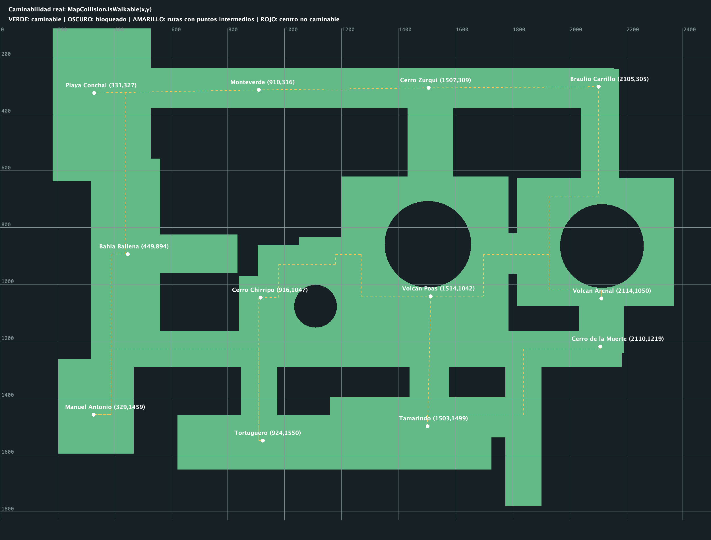

# jungle-attack-serverJungle Attack - 35%
Costa Rica holds about 6% of the planet's biodiversity. Out of that great pride, in OOP we are going to build a P2P battle game set in a Costa Rican forest. The game takes place on a map where the battles happen. The map is a forest in Costa Rica full of animals, with walkable paths that cross it and that players can walk along. There are up to 7 different types of animals, all of them native to Costa Rica.

Each player enters the game by choosing a nickname and deciding whether to create a new match or join an existing one. If it is a new match, the match is created and assigned a 4-character code that is displayed and identifies the match, and the player waits for a second player to join. When the player chooses to join a match, they must type the 4-character alphanumeric code that identifies the match they want to join.

Once there are two players in the match, each one must choose which of the 7 animals they will use. Both players cannot use the same animal. The 5 animals that are not selected become bots in the game.

7 packs are created in the match, 1 for each animal type:

Player packs have 10 members, 20 energy points, and a damage capacity of 2.
Bot packs have 4 members, 10 energy points, and a damage capacity of 1.
The map must be divided into 12 zones. Each player can see only one zone at a time, depending on whether they send pack members to explore the map. The zones are connected by paths. The player can select one or more pack members and send them walking by indicating where on the map the selected members should go.

Animals walk on their own at a constant speed once a destination is set. Each player is placed in a random zone of the map, and so are the bots, so that the 7 packs start in different zones.

A flag of a given color is placed in each player's zone. The player's goal is to find the opponent's zone and touch the opponent's flag.

If a player's animals run into a bot pack, the bot pack attacks them automatically. If a player's animal runs into an animal of the other player, the player must explicitly select one or more of their animals and indicate which animal to attack. The same applies to bot packs: to fight back, the player must select their animals and indicate which animal to attack.

Attacks happen at a rate of 1 attack per second. Therefore, if a player's animal with 20 energy runs into a bot pack of 4 with 10 energy each, the player's animal could die in 5 seconds, since it receives 4 attacks of damage 1 every second. Meanwhile, the player's animal could kill one of the bots at second 5, after making 5 attacks of damage 2.

There are a total of 10 cups of Costa Rican coffee placed along the paths of the map. If a player's animal picks up one of the cups, the damage capacity of every animal in that player's pack increases by 1.

For every two bots a player kills, each animal in that player's pack gains 1 energy point, but the maximum is always 20.

When a player manages to touch the opponent's flag, that player wins and the match ends, showing a summary with the bots eliminated, the animals eliminated from each pack, the number of coffee cups consumed by each player, and how long the match lasted.

What the student must do
Create two git projects: one for the client game and another one for the server.
In each project, design the specification of the classes, methods, and packages.
Include additional details in this spec, such as what will be static, where there is inheritance, interfaces, and polymorphism, and mark the classes that act as participants of specific design patterns.
Using those specs, create the class diagram with Mermaid and document it in the README.md. Push it to git and ask the professor for a review.
Implement the server classes, algorithms, and logic.
Implement the client classes, algorithms, and logic.
Every package must have a main class that can be unit tested in Java. Use AI to create the tests, and an automation that runs them to guarantee unit stability of the classes. It is recommended to do this once the classes are more stable and only going through minimal changes.
The game must be 100% functional, with basic movements and animations.
The game is controlled mainly with the mouse.
Sound in the game is optional.
Research for a path finding algorithm walking in the map.
Technical Implementation Clarifications (Java)
This section clarifies technical aspects of the implementation. It does not add new functional requirements. Items described as recommended are suggestions, and the student may choose a different approach as long as it is justified in the spec and validated with the professor.

1. Clarifications on the game rules
Some rules in the description can be read more than one way. Unless the professor indicates otherwise, use the following interpretation and document it in the README.md:

Topic	Interpretation
"P2P"	It refers to a player vs. player match. Technically the architecture is client-server: the two clients never talk to each other directly, and every message goes through the server.
Match code	4 alphanumeric characters (for example A7K2), generated by the server, unique among the active matches. Comparison is case-insensitive.
Energy	Energy is per animal: each animal of a player pack starts with 20, and each bot starts with 10. An animal dies when its energy reaches 0.
Damage capacity	It is a property of the pack, shared by all its members. Every attack takes damage energy points from the target.
"Run into"	Two animals run into each other when the distance between them is less than or equal to an encounter radius defined in the constants (ENCOUNTER_RADIUS).
Bot attack	When a player animal enters the radius of a bot, every bot of that pack within range attacks it automatically (this is what produces the 4 attacks per second in the example). Bots do not attack each other.
Player attack	Player animals never attack automatically. The player selects animals and clicks a target. Each selected animal attacks that target once per second while it is within range. If the target dies or leaves the range, the attack stops.
Visibility (fog of war)	The player sees one zone at a time on screen. A zone can only be shown with its contents (bots, opponent's animals, cups, flag) if at least one of the player's living animals is currently in it. The player can switch between the zones where they have animals.
Movement	Animals move only along the paths, at a constant speed (ANIMAL_SPEED). If the destination is in another zone, the route is computed over the graph of zones (BFS is enough, or Dijkstra if paths have different lengths).
Coffee cups	There are 10 in total, at random walkable positions from the start. They do not respawn. Only player animals consume them, once each. The +1 damage applies cumulatively to the whole pack.
Energy bonus	Every time the bots killed counter of a player reaches a multiple of 2, every living animal of their pack gains +1 energy, never exceeding MAX_PLAYER_ENERGY = 20.
Flag	The flag is touched when an animal of the opponent enters the flag's radius. The match ends immediately.
Starting zones	The 7 packs (2 players + 5 bots) are placed in 7 different zones chosen at random out of the 12.
2. Recommended technology stack
Aspect	Recommendation
Java version	Java 17 or 21 (LTS). Both projects must use the same version.
Build tool	Maven or Gradle. It makes dependency management and running the tests from the command line simple (mvn test).
JSON	Gson or Jackson. Do not build JSON by concatenating strings.
UI	Swing (JFrame + a custom JPanel that overrides paintComponent) or JavaFX. Swing is usually simpler for 2D drawing.
SVG	Java cannot draw SVG natively. Use a library: JSVG (lightweight, works with Swing) or Apache Batik (it can rasterize the SVG to a BufferedImage). Load and rasterize each image once at startup and keep it in a cache. Do not parse the SVG on every frame.
Tests	JUnit 5, optionally Mockito to mock sockets and dependencies.
Test automation	GitHub Actions running mvn test (or gradle test) on every push, in both repositories.
3. Client-server communication
Server: a ServerSocket on a configurable port (constant or config.properties). For each accepted connection, a ClientHandler runs in its own thread (or in an ExecutorService).
Message framing: a TCP socket is a stream of bytes, not of messages. The recommended approach is one JSON object per line (PrintWriter.println / BufferedReader.readLine), always in UTF-8.
Message envelope: every message has a type field and a payload. Example:
{ "type": "MOVE_ANIMALS", "payload": { "animalIds": [3, 4, 7], "targetX": 812, "targetY": 344 } }
Suggested message types:

Direction	Type	Purpose
Client → Server	CREATE_MATCH	Nickname. The server replies with the code.
Client → Server	JOIN_MATCH	Nickname + code.
Client → Server	SELECT_ANIMAL	Chosen species.
Client → Server	MOVE_ANIMALS	Selected ids + destination.
Client → Server	ATTACK	Selected ids + target id.
Client → Server	VIEW_ZONE	Zone the player wants to see.
Server → Client	MATCH_CREATED / MATCH_JOINED / ERROR	Lobby responses (invalid code, match full, species already taken).
Server → Client	ANIMAL_SELECTION	Available species and the opponent's choice.
Server → Client	GAME_STARTED	Initial own pack and fog-filtered state; the server never sends the full map.
Server → Client	STATE_UPDATE	Fog-filtered state snapshot: positions, energies, visible cups, flags.
Server → Client	GAME_OVER	Winner and summary.
The server is the authority. All rules (movement, combat, cups, bonuses, victory) are computed on the server. The client only sends the player's intentions and draws what it receives. This prevents cheating and keeps both clients consistent.
Visibility is enforced on the server. The server only sends each client the information of the zones that client is allowed to see. The client should not receive the whole map and hide it.
Disconnection: if either player disconnects, the match is cancelled without declaring a winner. The remaining client receives MATCH_CANCELLED. Always close sockets in a finally or with try-with-resources.
N matches: MatchManager keeps a ConcurrentHashMap<String, GameSession> indexed by code. When a match ends, it is removed from the map.
1 attack per second: keep a cooldown per animal (for example, lastAttackTime) and only allow a new attack when ATTACK_COOLDOWN_MS = 1000 have passed. Do not use Thread.sleep per animal.
Constant speed: on each tick, the animal advances ANIMAL_SPEED * deltaTime towards the next point of its route. ANIMAL_SPEED is 100 map pixels per second. Using the elapsed time (deltaTime) keeps the speed constant even if a tick is delayed.
4. Client: UI, mouse, and threads
Network thread separate from the UI thread. A thread reads messages from the socket. That thread must not touch Swing components directly: use SwingUtilities.invokeLater(...) (in JavaFX, Platform.runLater(...)).
Observer + MVC: the client model is updated with each STATE_UPDATE and notifies the views (Observer). The view only draws. The controller converts mouse events into commands. The view does not contain game logic.
Basic animation: redraw with a javax.swing.Timer (for example, 30 FPS). To make movement smooth, interpolate the position between the last two snapshots received.
Visual feedback: highlight selected animals, show energy bars, the current damage capacity, the number of cups, and the bots killed.
5. Unit tests and automation
Each package must have at least one main class covered by unit tests (JUnit 5). Tests go in src/test/java, mirroring the package structure.
Priorities for testing (pure logic, without UI or real sockets):
Combat: damage, death at 0 energy, 1 attack per second cooldown.
Energy bonus every 2 bots killed and the maximum of 20.
Coffee cup: +1 damage for the whole pack, consumed only once.
Match code generation (length, characters, uniqueness) and joining (invalid code, match full).
Species selection (two players cannot choose the same one; 5 remaining bots).
Movement at constant speed and route computation between zones.
JSON serialization/deserialization of every message type (round trip).
Victory condition when touching the opponent's flag.
Design for testability: inject dependencies (for example, pass a Random with a fixed seed or a Clock) so that random placement and time can be controlled in tests.
AI may be used to generate tests, but the student must understand and be able to explain each one.
Automation: a GitHub Actions workflow in each repository. Minimal example (.github/workflows/tests.yml):
Other Aspects
The solution architecture is client-server. The server and the client game UI are two separate applications, connected via sockets. Both are written in Java.
The format of the messages exchanged between the server and the client will be JSON.
All images must be in SVG format.
The work can be done individually or in pairs.
The server can support N matches.
The whole case must be tracked in git.
All classes must comply with good coding practices: encapsulation, separation of concerns, no hard-coded values in the code (use a constants library instead), and heavy reliance on inheritance and polymorphism.
The program must be written in Java.
The student may use any AI assistance; however, if the student is unable to understand, explain, and defend the code, the class design, and the algorithms, and cannot account for any line of code, they may lose between 20 and 60 points on the review, depending on the severity of the knowledge gap.
The review will take place in a scheduled appointment with the professor, and all work must be tracked in GitHub. It will be verified that both students contributed to the code during development; otherwise, the student may lose up to 15 points on the review.
Failing to demonstrate command of GitHub and the command line may cost up to 10 points on the review.
Last commit: Saturday, October 24, 2026.
Review with the professor by prior appointment.

## Running this server

Use Java 17 or newer (17 or 21 is recommended), `make`, and `curl`:

```sh
make start
make test
```

The Makefile downloads Gson 2.11.0 and, for tests only, the JUnit 5 console runner
into `build/deps/`. The first run requires internet access; subsequent runs use
the cached JARs. `make clean` removes the build directory and these downloads.
No Maven installation is required. Compilation targets Java 17.

### Responsibilities

- [Main](../src/main/java/cr/ac/tec/jungleattack/server/Main.java) starts the TCP server
  on port 12345. It contains no simulated clicks, hard-coded species, or local game loop.
- [Server](../src/main/java/cr/ac/tec/jungleattack/server/network/Server.java) accepts
  sockets and starts one thread per client. It closes connections on shutdown.
- [ClientHandler](../src/main/java/cr/ac/tec/jungleattack/server/network/ClientHandler.java)
  reads one UTF-8 JSON object per line, validates the envelope and fields, and writes
  responses using Gson. It does not implement a JSON parser or game rules.
- [MatchManager](../src/main/java/cr/ac/tec/jungleattack/server/network/MatchManager.java)
  owns the lobbies and game loop. After two connected players choose different
  species, it calls `Match.start(...)` once. Approximately every 33 ms it calls
  `updateTick(deltaTimeSeconds)` and sends a filtered snapshot to each player.
  A per-session lock prevents commands, ticks, and disconnects from changing the
  same match at the same time.
- [Match](../src/main/java/cr/ac/tec/jungleattack/server/game/Match.java) holds the
  game rules and state, not sockets or threads. It only advances when the server
  calls `updateTick(double)`. Players move or attack only after `MOVE_ANIMALS` or `ATTACK`;
  bot attacks, movement advancement, coffee collection, and victory checks run
  during ticks. There is no `initLocalGame()`, local timer, or duplicate click handler.
- [FogOfWar](../src/main/java/cr/ac/tec/jungleattack/server/game/FogOfWar.java) builds
  snapshots explicitly so serializing a match cannot accidentally expose its full
  map, opponent state, or object references. It sends the contents of one zone
  currently occupied by a living member of the player's pack, without a sight radius.
  Coordinates belong to their nearest zone center, including connecting paths.

The duration in the final summary still uses wall-clock time. The summary includes
all seven packs. Flags have stable colors: creator red (`#E53935`), joiner blue
(`#1E88E5`). Total elimination remains the only additional gameplay rule agreed
for this implementation; the original flag victory is preserved.

### JSON commands

Send one complete message per line. The server associates a connection with its
pack; clients cannot choose an owner or control another player's IDs.

```json
{"type":"CREATE_MATCH","payload":{"nickname":"Ana"}}
{"type":"JOIN_MATCH","payload":{"nickname":"Luis","code":"A7K2"}}
{"type":"SELECT_ANIMAL","payload":{"species":"MONO"}}
{"type":"MOVE_ANIMALS","payload":{"animalIds":[1,2],"targetX":910,"targetY":316}}
{"type":"ATTACK","payload":{"animalIds":[1,2],"targetId":21}}
{"type":"VIEW_ZONE","payload":{"zone":"Monteverde"}}
```

Names now follow the professor's document: the previous `SELECT_SPECIES`, `MOVE`
and `GAME_STATE` names were removed. Responses keep the `{ "type": ..., "payload": ... }` envelope:
`MATCH_CREATED`, `MATCH_JOINED`, `PLAYER_JOINED`, `ANIMAL_SELECTION`,
`GAME_STARTED`, `STATE_UPDATE`, `GAME_OVER`, `MATCH_CANCELLED`, or `ERROR`.
Each `STATE_UPDATE` includes `ownPack`, `ownFlagColor`, `ownAnimals`, `visibleZones`,
`selectedZone`, `visibleAnimals`, `visibleCoffeeCups`, and `visibleFlags`,
but never the full map. A final filtered `STATE_UPDATE` precedes `GAME_OVER`;
the result contains `winner`, `durationSeconds`, and all seven pack summaries.

Complete examples and receiver/generator methods:
[Protocol guide](PROTOCOLO.md),
[client JSON lines](cliente-a-servidor.jsonl),
[server JSON lines](servidor-a-cliente.jsonl).

### Tests and map limitations

`make test` runs repeatable JUnit tests for game rules and real TCP connections on
temporary local ports: lobby validation, species uniqueness, JSON errors,
selected-unit movement, formation, combat/cooldown, energy bonuses, coffee,
fog filtering, flag capture, total elimination, and disconnects across two matches.

A* searches the zone graph using the lengths of the actual connection polylines.
When a formation's offset route is blocked, `WalkablePathFinder` searches walkable
coordinates from the animal's actual position, including detours inside one zone.
It checks every segment against the collision map and replans around living
teammates after half a second without progress. Its grid uses 8 px spacing,
refining to 4 px when needed to pass tight gaps. Exact positions and rounded
collision cells are both checked when leaving contact with another animal.

The narrow rectangle `(1480,1200)` to `(1539,1506)` connects Poas to Tamarindo.
The one-pixel seam at y=598 in the Conchal-Bahia Ballena corridor was also closed:
the existing lower rectangle now starts at y=598 rather than y=599.
Zone centers, other rectangles and craters are unchanged.

Single-animal orders use the clicked position without the old global formation
offset. Group destinations are distinct walkable slots inside the requested zone.
Inter-zone arrivals and repeated individual orders leave wider gaps so parked
animals do not seal off the remaining slots. Nearby moves keep the compact
formation. The minimum rounded center distance between teammates is 24 px.
Movement advances at most one pixel per internal step, even after a delayed tick.

Bots choose connected zones to patrol without client commands, stop in encounter
range to attack, and resume patrols when no player is in range. A successful hit
increments an attack sequence and exposes its target coordinates for 300 ms in
filtered snapshots. This drives client feedback without client-side damage.

`make test` runs the unit/TCP suite AND the exhaustive movement diagnostic.
It can also be run independently:

```sh
make compile
java --class-path "build/classes:build/deps/gson-2.11.0.jar" tools/PathProbe.java
```

It issues real `Match.moveCommand` orders to ten living animals for every ordered
pair of distinct zones (132 pairs), then runs `Match.updateMovement` without
combat or early flag victory. Each tick checks all ten centers for walkability
and coincident coordinates. Collision checks inspect the actual substeps rather
than a straight chord that would cut across valid turns. It repeats at 30 FPS
and with one-second delayed ticks, and tests
individual orders to the same point. Results go to `build/prueba-caminos.csv`;
the command exits with an assertion failure if these requirements are unmet.

The diagnostic requires all 528 scenarios to complete with ten arrivals,
no blocked crossings and no teammate separation below 24 px.
These simulations start from the
formation in each zone and isolate movement from combat/flag termination; they do
not claim to cover all possible mid-route redirections or crowd conflicts.

### Exact map visualization

[Open the updated SVG](mapa-colisiones-actual.svg) or
[PNG preview](mapa-colisiones-actual.png). Green pixels come directly from
`isWalkable(x,y)`; dark pixels are blocked. The defined walkable rectangles have
been expanded 40 map pixels on each side to make paths less narrow, while crater
obstacles remain blocked. Yellow dashed lines follow the actual stored polylines.
A red marker would identify a non-walkable zone center.



Reproduce the images without extra dependencies:

```sh
make compile
java -Djava.awt.headless=true --class-path build/classes tools/MapPreview.java docs/mapa-colisiones-actual
```

The exported SVG is vector data; PNG is only a diagnostic preview, not a game asset.

## Class specification and diagram

[SPEC.md](SPEC.md) lists classes, attributes, methods, and relationships in the
layer-based format of the supplied class specification. Physical center-to-center
routes now pass the exhaustive tests; the actual client still needs validation.
No additional gameplay features are planned.
The Makefile is the documented alternative to installing Maven/Gradle.
Tests run locally with `make test`; GitHub Actions runs that same target on pushes
and pull requests. A successful local run does not prove that the remote workflow
has already executed. The copyable Mermaid source below is also exported as
[diagrama.mmd](diagrama.mmd).

```mermaid
classDiagram
    class Main {
        +main(String[] args)$ void
    }
    class Server {
        -ServerSocket listener
        -MatchManager matchManager
        -Set~ClientHandler~ clients
        +start() void
        +close() void
    }
    class ClientHandler {
        -Gson JSON$
        -Socket socket
        -MatchManager matchManager
        +run() void
        +send(String type, Object payload) boolean
    }
    class Message {
        <<record>>
        -String type
        -Object payload
    }
    class MatchManager {
        -ConcurrentHashMap matches
        -ConcurrentHashMap playerSessions
        -ScheduledExecutorService gameLoop
        +handleMessage(ClientHandler client, String type, JsonObject payload) void
        +onDisconnect(ClientHandler client) void
    }
    class GameSession {
        -String code
        -ClientHandler[] clients
        -AnimalSpecies[] species
        -Match match
        -ScheduledFuture tick
    }
    class Match {
        -MapGraph map
        -List~Pack~ packs
        -List~CoffeeCup~ coffeeCups
        -Pack winner
        -boolean running
        +start(AnimalSpecies first, AnimalSpecies second) void
        +updateTick(double seconds) void
        +updateMovement(double seconds) void
        +moveCommand(Pack player, List ids, int x, int y) boolean
        +attackCommand(Pack player, List ids, int targetId) boolean
        +cancel() void
    }
    class MapFactory {
        +createCostaRicaMap()$ MapGraph
        +buildCostaRicaCollisions()$ MapCollision
    }
    class MapGraph {
        -Map paths
        -MapCollision collision
        +addPath(Zone from, Zone to, List points) void
        +getPath(Zone from, Zone to) List
        +getPathLength(Zone from, Zone to) double
        +getZoneByCoordinates(int x, int y) Zone
    }
    class MapCollision {
        -List walkableRects
        -List obstacleCircles
        +isWalkable(int x, int y) boolean
        +isSegmentWalkable(int x1, int y1, int x2, int y2) boolean
    }
    class CircleObstacle {
        +contains(int x, int y) boolean
    }
    class Zone {
        -String name
        -int x
        -int y
    }
    class PathFinder {
        +findShortestPath(MapGraph map, Zone start, Zone end)$ List
    }
    class WalkablePathFinder {
        +findPath(MapCollision map, Point2D start, Point target, List occupied)$ List
    }
    class Candidate {
        <<record>>
        -Zone zone
        -double priority
    }
    class FogOfWar {
        +createSnapshot(Match match, Pack viewer, String zone) Map
        +canViewZone(Match match, Pack viewer, String zone) boolean
    }
    class Flag {
        -Zone zone
        -Pack owner
        -String color
        -boolean captured
        +isTouchedBy(Animal animal) boolean
    }
    class CoffeeCup {
        -int x
        -int y
        -boolean consumed
        +consumeBy(Animal animal) boolean
    }
    class Pack {
        -AnimalSpecies species
        -int damageCapacity
        -List~Animal~ members
        -int botsKilled
        -int animalsEliminated
        -int cupsConsumed
    }
    class Animal {
        <<abstract>>
        #int id
        #int energy
        #double x
        #double y
        -Deque waypoints
        -double cooldownSeconds
        +updateMovement(double seconds, MapCollision collision) void
        +updateMovement(double seconds, MapCollision collision, List teammates) void
        +getTargetPosition() Point
        +isMoving() boolean
        +isAlive() boolean
    }
    class PlayerAnimal {
        -Animal attackTarget
        +attack(Animal target, int damage) boolean
    }
    class Bot {
        +autoAttack(List enemies, int damage) void
    }
    class MatchSummary {
        -AnimalSpecies winnerSpecies
        -long durationSeconds
        -List~PackSummary~ packs
    }
    class PackSummary {
        -AnimalSpecies species
        -int botsKilled
        -int animalsEliminated
        -int cupsConsumed
    }
    class GameConstants {
        <<constants>>
        +int PORT$
        +int ENCOUNTER_RADIUS$
        +int MAX_PLAYER_ENERGY$
    }
    class AnimalSpecies {
        <<enumeration>>
        MONO
        MARIPOSA
        RANA
        PEREZOSO
        SERPIENTE
        TORTUGA
        YIGUIRRO
    }
    class Runnable {
        <<interface>>
    }
    class AutoCloseable {
        <<interface>>
    }
    Main ..> Server : starts
    Server ..|> AutoCloseable
    Server *-- MatchManager
    Server o-- ClientHandler
    ClientHandler ..|> Runnable
    ClientHandler ..|> AutoCloseable
    ClientHandler ..> MatchManager : commands
    ClientHandler ..> Message : serializes
    MatchManager ..|> AutoCloseable
    MatchManager *-- GameSession
    GameSession o-- "2" ClientHandler
    GameSession *-- "0..1" Match
    MatchManager --> FogOfWar : filtered snapshots
    Match *-- "7" Pack
    Match *-- "2" Flag
    Match *-- "10" CoffeeCup
    Match *-- MapGraph
    Match --> MatchSummary
    Match ..> PathFinder
    Match ..> WalkablePathFinder
    Match ..> MapFactory
    MapFactory ..> MapGraph
    MapFactory ..> MapCollision
    MapGraph *-- "12" Zone
    MapGraph *-- MapCollision
    MapCollision *-- CircleObstacle
    PathFinder ..> MapGraph
    PathFinder ..> Candidate
    Candidate --> Zone
    Pack *-- "4 or 10" Animal
    Pack --> AnimalSpecies
    Animal <|-- PlayerAnimal
    Animal <|-- Bot
    Animal ..> MapCollision
    PlayerAnimal --> Animal : attack target
    Flag --> Zone
    Flag --> Pack : owner
    CoffeeCup ..> PlayerAnimal
    FogOfWar ..> Match
    MatchSummary *-- "7" PackSummary
    PackSummary --> AnimalSpecies
    Animal ..> GameConstants
    Match ..> GameConstants
    class MatchTest
    class ServerTest
    class AnimalTest
    class PathFinderTest
    class GameConstantsTest
    class ProtocolTest
    class Peer
    class MapPreview {
        +main(String[] args)$ void
    }
    MatchTest ..> Match : tests
    MatchTest ..> FogOfWar : tests
    ServerTest ..> Server : TCP tests
    ServerTest *-- Peer
    AnimalTest ..> Animal : tests
    PathFinderTest ..> PathFinder : tests
    GameConstantsTest ..> GameConstants : tests
    ProtocolTest ..> ClientHandler : JSON contract tests
    MapPreview ..> MapFactory : diagnostic only
```


